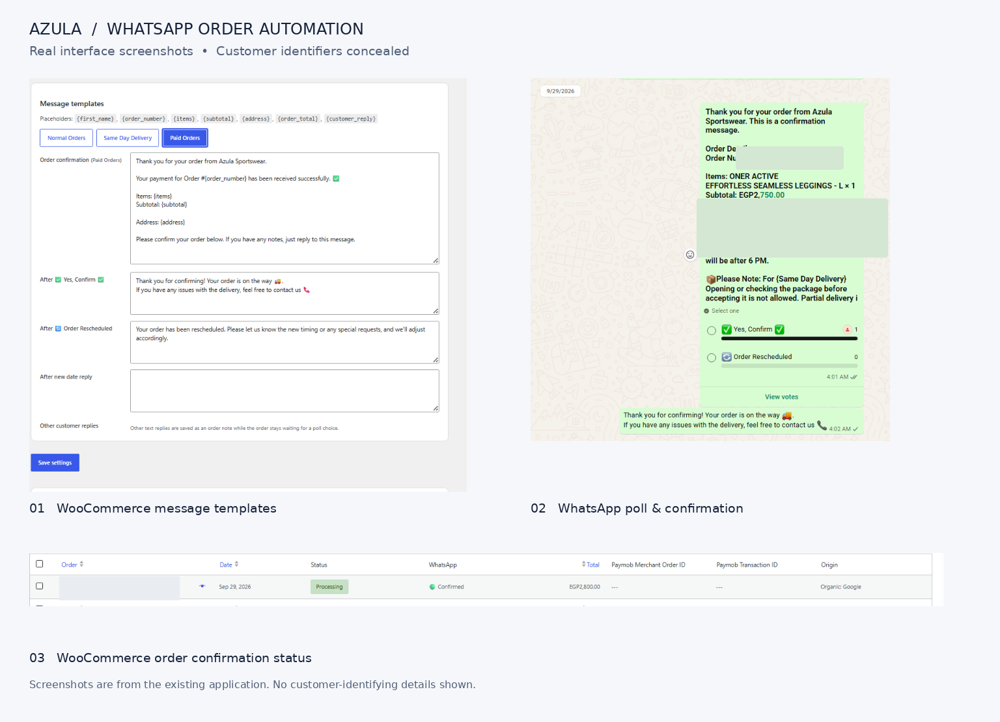
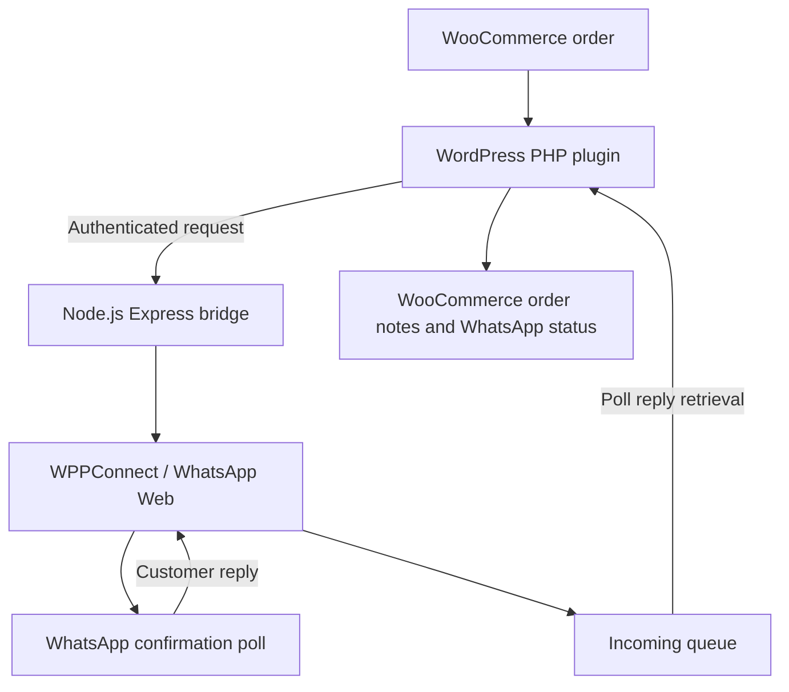

# Azula WhatsApp Automation

**WooCommerce order confirmations and customer rescheduling through WhatsApp polls**

A portfolio case study based on an order-messaging workflow developed for Azula Sportswear. The project connects a custom **WordPress/WooCommerce PHP plugin** with a **Node.js + Express WhatsApp bridge** using WPPConnect.

> **Portfolio source snapshot (plugin v0.2.6).** This public copy is intended to demonstrate the implementation and product workflow. It is not a production deployment package, has not been independently verified end-to-end, and does not include credentials, session files, or production backups. WPPConnect automates WhatsApp Web; it is not the official WhatsApp Business Platform API.

## Project showcase

*Application examples of message templates, a customer confirmation poll, and WooCommerce order confirmation status. Sensitive details should be hidden.*

## What it does

- Sends confirmation polls for eligible WooCommerce orders.
- Supports **three template types**: normal orders, same-day delivery orders when that shipping method is identified, and already-paid orders.
- Processes customer choices for **Confirm** or **Order Rescheduled**, with configurable follow-up replies.
- Records messaging and response information in WooCommerce and shows WhatsApp status on the orders list.
- Offers WordPress admin controls for message templates, connection status, test messages, and manual operations.
- Uses a Node.js bridge to communicate with a WPPConnect WhatsApp Web session.

## Architecture

## Technologies

| Layer | Technology |
| --- | --- |
| E-commerce | WordPress / WooCommerce |
| Plugin | PHP |
| Bridge | Node.js / Express |
| WhatsApp transport | WPPConnect / WhatsApp Web |
| Local packaging example | Docker Compose |

## Repository layout

- [`woocommerce-plugin/`](woocommerce-plugin/) — PHP WooCommerce plugin.
- [`whatsapp-bridge/`](whatsapp-bridge/) — JavaScript bridge and Docker example.
- [`docs/SECURITY-REVIEW.md`](docs/SECURITY-REVIEW.md) — limitations, risks, and public-source hygiene.
- [`docs/DEPLOYMENT-NOTES.md`](docs/DEPLOYMENT-NOTES.md) — conceptual configuration notes, **not** verified deployment instructions.

## Security and implementation limitations

This is a sanitized **historical code snapshot**, not a representation that all bugs or risks have been fixed. Before adapting it for production, review duplicate-send behavior, concurrency, customer-reply attribution, diagnostics/log privacy, API-key security, and integration tests. See the [security review](docs/SECURITY-REVIEW.md).

Do not upload actual `.env` files, WhatsApp authentication/session folders, logs, order exports, or server backups. Never deploy this snapshot over a working production bridge without a separate validation and rollback plan.

## Project credit

Built for Azula Sportswear through workflow design, testing, and **AI-assisted implementation and debugging**. Third-party dependencies remain subject to their own licenses.
